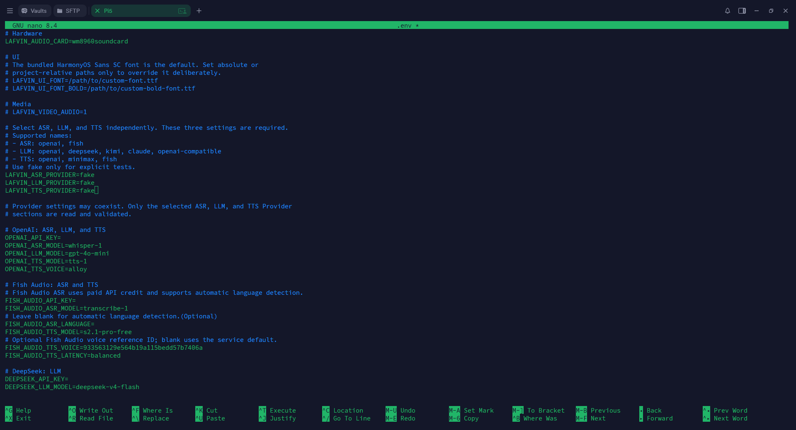

.. _troubleshooting-guide:

Troubleshooting
===============

Troubleshoot the system in the same order as the initial installation. First
check the power supply, HAT installation, and system login. Then check the
driver, followed by the Runtime and cloud configuration.

Cannot Log In over SSH
----------------------

* **Symptom**: The terminal reports a connection timeout, cannot find the host,
  or rejects the password.
* **Possible causes**: The Raspberry Pi has not started successfully; the
  network settings were not configured correctly in Raspberry Pi Imager; or
  the IP address, hostname, or username is incorrect.
* **Solutions**:

  1. Check the power and status indicators, then allow the first boot to finish.
  2. Find the Raspberry Pi's IP address on your router's administration page.
  3. Log in with the username configured in Raspberry Pi Imager instead of
     assuming that the username is ``pi``.
  4. If the Raspberry Pi still does not start, follow
     :ref:`Flash Raspberry Pi OS <flash-raspberry-pi-os>` to write the system
     image again.

Hardware Checks Report Failures
-------------------------------

* **Symptom**: ``bash tools/hardware_check.sh`` or
  ``sudo bash install_driver.sh --check`` reports one or more failures.
* **Possible causes**: The Raspberry Pi has not been restarted since the driver
  was installed; the HAT is not seated correctly on the GPIO header; the board
  model is unsupported; or SPI, I2C, I2S, or the WM8960 sound card is not
  enabled correctly.
* **Solutions**:

  1. Run ``sudo reboot``, log in again, and repeat the check.
  2. Shut down the Raspberry Pi and disconnect its power. Realign the HAT with
     the 40-pin GPIO header and reinstall it.
  3. Confirm that the board is a Raspberry Pi Zero 2 W, Raspberry Pi 3 Model B+,
     Raspberry Pi 4 Model B, or Raspberry Pi 5.
  4. From the project root, run ``sudo bash install_driver.sh`` again, then
     restart the Raspberry Pi.

Display, Button, or Audio Tests Fail
------------------------------------

* **Symptom**: The hardware test does not show the color blocks, the button
  does not respond, no test sound is played, or the recording cannot be played
  back.
* **Possible causes**: The Runtime is using the hardware; the HAT is not
  installed correctly; the audio service has not finished starting; or the
  power supply is unstable.
* **Solutions**:

  1. Stop the deployed service: ``sudo systemctl stop lafvin-hat``.
  2. Run the :ref:`Interactive Hardware Test <verify-hardware>` again and
     confirm each observed result.
  3. Run ``systemctl status wm8960-soundcard --no-pager`` and confirm that the
     service reports ``active (exited)``.
  4. Shut down the Raspberry Pi, check the HAT and speaker connections, and
     repeat the test with a stable 5 V power supply suitable for your
     Raspberry Pi model.

Runtime Does Not Start
----------------------

* **Symptom**: The startup command exits, or ``lafvin-hat.service`` does not
  report ``active (running)``.
* **Possible causes**: The virtual environment is not active; the Python
  dependencies are not installed; a manually started Runtime and the systemd
  service are running at the same time; or the Provider settings in the
  environment file are incomplete.
* **Solutions**:

  1. Open the project directory and activate the environment:
     ``source .venv/bin/activate``.
  2. Run ``python -m pip install -e ".[hardware,ai]"`` again.
  3. Use only one startup method. Stop the service during manual debugging, and
     do not start another Runtime manually while using the deployed service.
  4. Run ``sudo journalctl -u lafvin-hat -n 100 --no-pager`` to inspect service
     errors. To isolate cloud configuration issues, see
     :ref:`Use Fake Providers to Isolate the Problem <fake-provider-diagnostics>`.

AI Features Do Not Respond
--------------------------

* **Symptom**: Chatbot or Translator does not return a result after recording,
  and the logs report authentication, quota, or network errors.
* **Possible causes**: An API key is missing or invalid; the selected Providers
  do not match their API key settings; the API account has insufficient credit;
  or the deployed service has not loaded the latest configuration.
* **Solutions**:

  1. Check the Provider selections and API key variables in ``.env`` or
     ``/etc/lafvin-hat/runtime.env``.
  2. Confirm that the corresponding service account is active and has enough
     credit. Third-party API charges are separate from the product purchase.
  3. After modifying the persistent configuration, run
     ``sudo systemctl restart lafvin-hat``.
  4. To rule out network and account issues, see
     :ref:`Use Fake Providers to Isolate the Problem <fake-provider-diagnostics>`.

.. _fake-provider-diagnostics:

Use Fake Providers to Isolate the Problem
-----------------------------------------

The Fake Providers replace cloud-based speech recognition, model responses,
and speech synthesis with predefined text and test audio. Use them to determine
whether a problem is in the device's local workflow or in a cloud service. They
can verify recording files, the application flow, and audio playback, but they
cannot verify the network, API keys, real speech recognition, model responses,
or tool calls.

Edit the configuration file used by the current startup method:

* Foreground test: ``.env`` in the project directory.
* Systemd service: ``/etc/lafvin-hat/runtime.env``.

Record the current Provider settings, then temporarily change all three to:

.. code-block:: ini

   LAFVIN_ASR_PROVIDER=fake
   LAFVIN_LLM_PROVIDER=fake
   LAFVIN_TTS_PROVIDER=fake

For a foreground test, press ``Ctrl+C`` to stop the current Runtime. Save
``.env``, then start it again:

.. code-block:: bash

   lafvin-hat runtime start --env-file .env --backend lafvin-hat

To test the deployed service, save ``/etc/lafvin-hat/runtime.env`` and restart
the service:

.. code-block:: bash

   sudo systemctl restart lafvin-hat

Open Chatbot, press and hold the ``Talk`` button, speak, and then release it. If
the interface displays the predefined transcription and response and plays the
test audio, the local Runtime, application flow, and audio path are working.
Focus further troubleshooting on the network, API key, account credit, and
Provider configuration.

If the Fake Providers also fail, run:

.. code-block:: bash

   sudo journalctl -u lafvin-hat -n 100 --no-pager

Use the log output to continue checking the Runtime, application, or device
path.

.. warning::

   After troubleshooting, restore all three Providers to their previous real
   settings and restart the Runtime or systemd service. Do not use the Fake
   Providers for a production deployment unless you explicitly need an offline
   demonstration.
