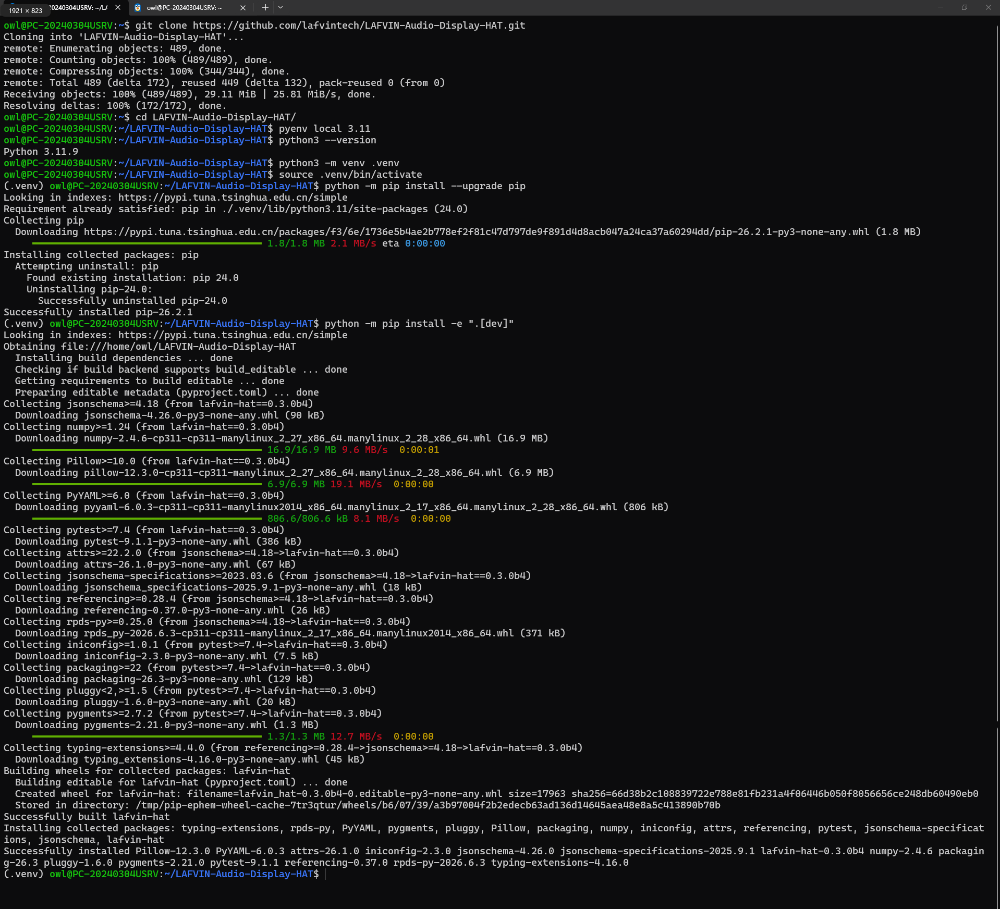
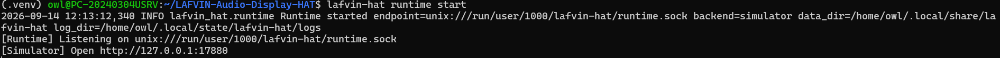
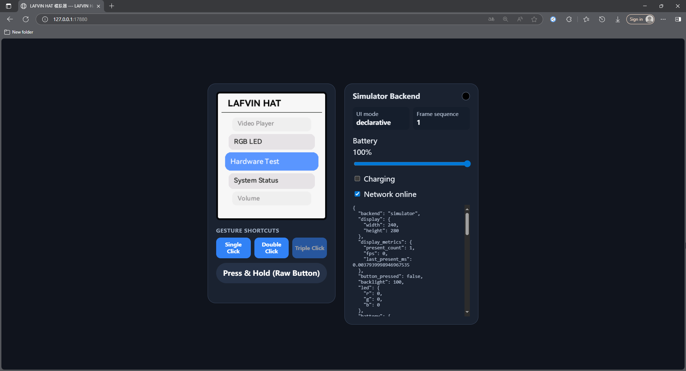
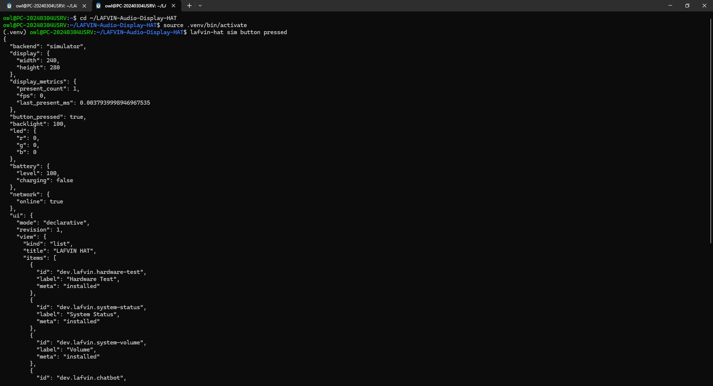

.. _wsl2-and-simulator:

2. Run the Simulator in WSL2
============================

Set Up WSL2
-----------

This guide uses Windows 10 or 11, WSL2, and Ubuntu. In an Administrator
PowerShell window, check the installed distributions:

.. code-block:: powershell

   wsl --list --verbose

``VERSION`` should be ``2``. If WSL is not installed, follow the
`Microsoft WSL installation guide
<https://learn.microsoft.com/windows/wsl/install>`_ and run the following
command in Administrator PowerShell:

.. code-block:: powershell

   wsl --install -d Ubuntu

Restart Windows when prompted. The first time you open Ubuntu, create a Linux
username and password.

.. note::

   Clone the repository into the WSL2 Linux home directory, such as
   ``~/LAFVIN-Audio-Display-HAT``, rather than under ``/mnt/c``. This avoids
   cross-filesystem permission differences and reduces file-access overhead.
   When using VS Code, run ``code .`` from the WSL terminal to connect the
   editor to the current Linux environment.

Python Version Requirements
---------------------------

The project requires Python 3.11 or later and declares support for Python 3.11,
3.12, and 3.13. First, install the basic tools and check the version in the
Ubuntu terminal:

.. code-block:: bash

   sudo apt update
   sudo apt install -y curl git python3 python3-venv
   python3 --version

If the output is ``Python 3.11.x``, ``3.12.x``, or ``3.13.x``, continue with
the project installation.

.. admonition:: If Python Is Older Than 3.11

   Use `pyenv <https://github.com/pyenv/pyenv>`_ to install a separate Python
   3.11 environment for this project instead of replacing Ubuntu's
   ``/usr/bin/python3``. First, install pyenv and configure the current Bash
   environment:

   .. code-block:: bash

      curl -fsSL https://pyenv.run | bash
      ~/.pyenv/bin/pyenv init --install
      exec "$SHELL"

   After the Ubuntu prompt returns, install the required build dependencies
   and Python 3.11:

   .. code-block:: bash

      pyenv install-prerequisites
      pyenv install 3.11

   Keep this terminal open and continue with the project installation below.

Install the Project
-------------------

After confirming the Python version, run the following commands in the Ubuntu
terminal:

.. code-block:: bash

   cd ~
   git clone https://github.com/lafvintech/LAFVIN-Audio-Display-HAT.git
   cd ~/LAFVIN-Audio-Display-HAT

If you installed Python 3.11 with pyenv in the previous section, select it for
this project and confirm the version:

.. code-block:: bash

   pyenv local 3.11
   python3 --version

The version should be ``Python 3.11.x``. ``pyenv local`` applies only inside
the project directory and does not modify the Python installation used by
Ubuntu itself. If the system Python was already supported, skip this step.

Create the virtual environment and install the project:

.. code-block:: bash

   python3 -m venv .venv
   source .venv/bin/activate
   python -m pip install --upgrade pip
   python -m pip install -e ".[dev]"

The WSL2 simulator does not require the ``hardware`` dependencies or
``install_driver.sh``.

When the installation finishes, the terminal should return to the command
prompt without red dependency-resolution or installation errors. Package
versions and download progress shown in the screenshot may change as the
project is updated.

Start the Simulator
-------------------

Keep the virtual environment active and run:

.. code-block:: bash

   lafvin-hat runtime start

When ``--backend`` is not specified, the Runtime uses ``simulator`` by default.
Open the following address in a Windows browser:

.. code-block:: text

   http://127.0.0.1:17880

As described in the `Microsoft WSL networking documentation
<https://learn.microsoft.com/windows/wsl/networking>`_, a Windows browser can
access a web application running in WSL2 through ``localhost``. This project
listens only on the local machine by default. The simulator page should show a
240×280 device display, button controls, the RGB LED, backlight, battery, and
network status.

The Runtime prints the simulator address when it starts. Keep this terminal
running. Closing it or pressing ``Ctrl+C`` stops both the Runtime and the
simulator web service.

After opening the address in a Windows browser, the left side shows a virtual
display matching the HAT screen dimensions. The right side contains simulated
controls for the button, RGB LED, backlight, battery, and network status. If
the Home screen icons appear and the controls respond, the browser is connected
to the Runtime in WSL2.

.. note::

   When no ``.env`` file is loaded, the AI Providers default to ``fake``. This
   is suitable for previewing the local Chatbot and Translator flows in the
   simulator, but it does not call live cloud services.

Simulate Button Input
---------------------

Use the single-click, double-click, and triple-click controls on the page to
test standard navigation. To test the timing of button presses and releases,
use the Raw Button controls. You can also inject raw button events from a
second WSL2 terminal:

.. code-block:: bash

   cd ~/LAFVIN-Audio-Display-HAT
   source .venv/bin/activate
   lafvin-hat sim button pressed
   lafvin-hat sim button released

After each command, the terminal should confirm that the button state was
updated, and the browser simulator should receive the corresponding press or
release event. This method is useful for applications that require precise
control over how long the button is held.

If port ``17880`` is already in use, start the simulator on another port:

.. code-block:: bash

   lafvin-hat runtime start --simulator-port 18080

Then open ``http://127.0.0.1:18080``. When finished, press ``Ctrl+C`` in the
Runtime terminal to stop it.

Simulator Validation Scope
--------------------------

The simulator can validate:

* Home screen navigation and application switching.
* UI Toolkit and Raw Frame output.
* Single-click, double-click, triple-click, press, and release interactions.
* RGB LED, backlight, battery, and network-status logic.
* Application startup, exit, logging, and Runtime/SDK communication.

The simulator cannot validate real LCD color and refresh behavior, GPIO or SPI
timing, the WM8960, microphones, speakers, power behavior, or Raspberry Pi
performance. Test animations and video again on the target Raspberry Pi model.
