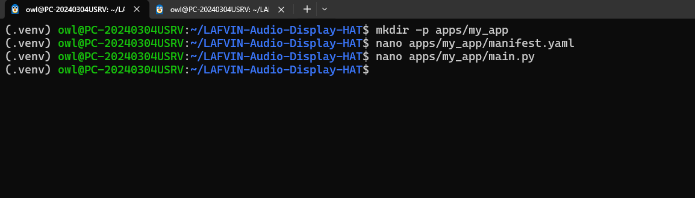
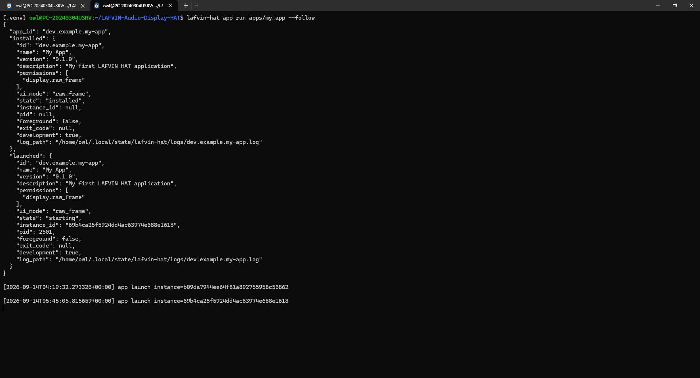
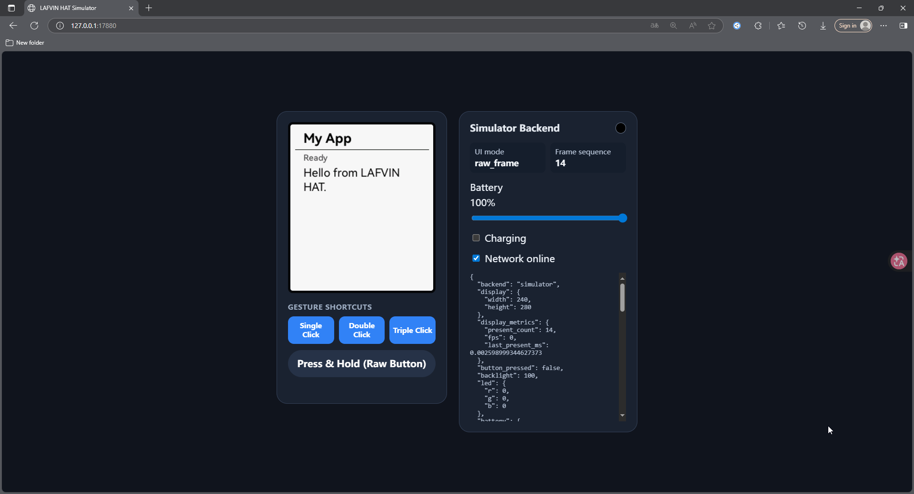

.. _develop-an-app:

3. Develop an Application with the Simulator
============================================

This chapter creates a minimal UI Toolkit application and uses
``lafvin-hat app run`` to register and start it directly from its working
directory. This workflow is suitable for repeated code changes and does not
copy the development directory into the Runtime's persistent storage.

Create the Application Directory
--------------------------------

Run the following commands from the project root:

.. code-block:: bash

   mkdir -p apps/my_app
   nano apps/my_app/manifest.yaml

Enter the following application manifest:

.. code-block:: yaml

   schema_version: 1
   id: dev.example.my-app
   name: My App
   version: 0.1.0
   description: My first LAFVIN HAT application

   entrypoint:
     executable: python
     args:
       - main.py
     working_directory: .

   permissions:
     - display.raw_frame

   ui:
     mode: raw_frame

   lifecycle:
     startup_timeout_sec: 10
     exit_timeout_sec: 3
     restart: never
     max_restarts: 0

Use your own reverse-domain application ID and make sure it is unique. This
example only displays a frame, so it requests only the ``display.raw_frame``
permission. Add the ``button``, ``microphone``, or ``speaker`` permissions only
when the application actually requires those capabilities.

Create the Entrypoint
---------------------

Run ``nano apps/my_app/main.py`` and enter:

.. code-block:: python

   from __future__ import annotations

   import asyncio

   from lafvin_hat.sdk import DeviceApp
   from lafvin_hat.ui import Canvas

   async def main() -> None:
       app = await DeviceApp.connect_from_environment()
       await app.acquire_foreground()
       frame = await app.frames.acquire()
       try:
           await (
               Canvas(width=frame.width, height=frame.height)
               .text_page(
                   "My App",
                   "Hello from LAFVIN HAT.",
                   status="ready",
               )
               .present(frame)
           )
           async for event in app.subscribe(events=["app.exit_requested"]):
               if event["event"] == "app.exit_requested":
                   break
       finally:
           await app.close()

   if __name__ == "__main__":
       asyncio.run(main())

Keep ``app.close()`` inside ``finally`` so that the application releases its
frame, audio resources, and foreground ownership during both normal exits and
exceptions. The Runtime handles the global triple-click exit gesture and sends
``app.exit_requested`` to the application.

Run and Preview the Application
-------------------------------

Start the simulator Runtime in the first WSL2 terminal:

.. code-block:: bash

   cd ~/LAFVIN-Audio-Display-HAT
   source .venv/bin/activate
   lafvin-hat runtime start

Keep the Runtime running and execute the following commands in a second
terminal:

.. code-block:: bash

   cd ~/LAFVIN-Audio-Display-HAT
   source .venv/bin/activate
   lafvin-hat app run apps/my_app --follow

The browser simulator should show the title ``My App``, the status ``Ready``,
and the message ``Hello from LAFVIN HAT.`` After modifying ``main.py``, run the
same ``app run`` command again to register and start the current version from
the working directory.

.. warning::

   Do not run ``python apps/my_app/main.py`` directly. The application requires
   the Runtime to inject the IPC endpoint, application ID, and permission
   information. Direct execution does not provide the complete environment.

View Status and Logs
--------------------

If the application does not appear, run:

.. code-block:: bash

   lafvin-hat app list
   lafvin-hat status
   lafvin-hat logs dev.example.my-app --follow

Use ``status`` to check the active device backend, foreground application, Raw
Frame owner, and commit count. If the application fails before drawing, check
its logs first. If the application is running but the display is blank, check
``frame.active``, ``frame.owner_app_id``, and
``frame.metrics.commit_count``.

Complete the Development Checklist
----------------------------------

Before copying the application to the Raspberry Pi, confirm that:

* The manifest requests only the permissions the application actually needs.
* Both normal and exceptional exit paths call ``app.close()``.
* Text fits within the 240×280 display, and long content can wrap or scroll.
* A triple-click exits the application and returns to the Home screen.
* ``lafvin-hat app run apps/my_app --follow`` reports no unhandled exceptions.
* The automated tests pass.

Copy the Application to the Raspberry Pi
----------------------------------------

After completing the WSL2 simulator tests, copy the application directory to a
Raspberry Pi that has been deployed according to Part 3. Run the following
command from the project root in WSL2:

.. code-block:: bash

   scp -r apps/my_app <username>@<raspberry-pi-ip>:~/LAFVIN-Audio-Display-HAT/apps/

Replace ``<username>`` and ``<raspberry-pi-ip>`` with the Raspberry Pi login
username and IP address. If the application is maintained in its own Git
repository, you can use Git to obtain the same source version on the Raspberry
Pi instead.

.. warning::
   Do not store API keys, ``.env`` files, personal credentials, or a local
   virtual environment inside the application directory. Persistent
   installation copies the contents of this directory.

Test on Real Hardware
---------------------

Log in to the Raspberry Pi through SSH and confirm that the Runtime service
deployed in Part 3 is running:

.. code-block:: bash

   sudo systemctl status lafvin-hat --no-pager

Do not start a second Runtime manually. From the project directory, use the
existing service to register and run the development version:

.. code-block:: bash

   cd ~/LAFVIN-Audio-Display-HAT
   lafvin-hat app run apps/my_app --follow

Depending on the permissions used by the application, test the display layout,
button, RGB LED, microphones, speaker, and network features. Confirm that the
logs contain no unhandled exceptions. When testing is complete, triple-click
the button to exit the application. You can also run the following command in
another SSH terminal:

.. code-block:: bash

   lafvin-hat app stop dev.example.my-app

Use ``app stop`` only while the application is still running. Pressing
``Ctrl+C`` in the ``--follow`` view stops log following, but the application
may continue running. A running application cannot be replaced by a
persistently installed version.

Install the Application Persistently
------------------------------------

After the real-hardware tests pass and the application has exited, run the
following commands from the project directory on the Raspberry Pi:

.. code-block:: bash

   lafvin-hat app install apps/my_app
   lafvin-hat app list

Do not add ``--dev``. ``app install`` copies the current application directory
into Runtime-managed persistent storage. ``development`` should be ``false``
in the application list, and ``My App`` should appear on the Home screen.
Double-click to open it and triple-click to exit and return Home.

.. note::
   ``app install`` copies application files but does not install additional
   Python packages or system software. If the application adds third-party
   dependencies, install them in the Raspberry Pi project's ``.venv`` first
   and record the installation requirements in the application documentation.

Persistent installation uses a copy of the source taken at installation time.
Later changes to the original ``apps/my_app`` directory do not immediately
affect the installed version. Run ``app install`` again to update it.

Verify Persistence After a Restart
----------------------------------

Restart the Runtime service and check the application list again:

.. code-block:: bash

   sudo systemctl restart lafvin-hat
   lafvin-hat app list

Confirm that ``My App`` remains in the application list and on the Home screen.
Open it again, check the display, and confirm that triple-click exits normally.
Before the final release, also restart the Raspberry Pi and confirm that the
behavior remains the same after boot.

.. _update-or-uninstall-app:

Update or Uninstall the Application
-----------------------------------

To update the application, first copy the new source to the Raspberry Pi. If
the current version is running, exit it or use ``app stop``, then reinstall it:

.. code-block:: bash

   lafvin-hat app install apps/my_app

Reinstalling replaces the Runtime-managed application copy. You must also stop
the application before uninstalling it. Then run:

.. code-block:: bash

   lafvin-hat app uninstall dev.example.my-app
   lafvin-hat app list

Uninstalling a persistent application removes the Runtime-managed copy but does
not delete the original ``apps/my_app`` source directory or the separately
stored application logs.

For more complex features, refer to ``apps/system_status``,
``apps/system_volume``, ``apps/chatbot``, ``apps/one_button_jump``, and
``apps/video_player``. Choose the application closest to your requirements as
a starting point.
