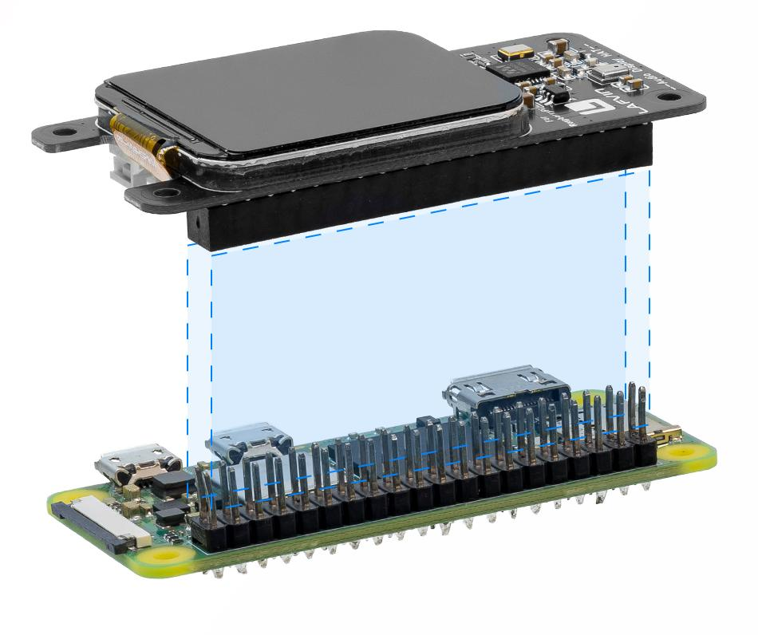

.. _install-hat:

Install the Audio Display HAT
=============================

Install the HAT on the 40-pin GPIO header while the Raspberry Pi is completely
powered off. The HAT receives power and communicates with the Raspberry Pi
through this header, so it does not require a separate power supply.

Installation Steps
------------------

1. Shut down the Raspberry Pi and disconnect the USB-C or other power cable.
2. Insert the prepared microSD card into the Raspberry Pi.
3. Locate the Raspberry Pi's 40-pin GPIO header and the 40-pin female connector
   on the underside of the HAT.
4. Make sure both rows of pins are fully aligned. Keep the HAT level and press
   it down gently until the connection is secure.
5. Check that the connector is not offset by one row, that no pins are exposed,
   and that no metal objects are touching either circuit board.

.. danger::
   Do not force the HAT into place. If it does not install smoothly, remove it
   and check its orientation. A misaligned connection may damage the Raspberry
   Pi or the HAT. Hold the HAT by the edges of its PCB and avoid pressing on the
   display.

First Startup
-------------

Connect a stable 5 V power supply suitable for your Raspberry Pi model. The
first startup may take several minutes while the system completes its initial
setup and connects to the network. Do not disconnect the power during startup.

Next, follow :ref:`First Boot and Login <first-boot-and-login>` to log in to the
system.
