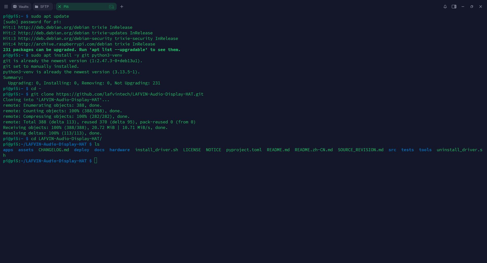
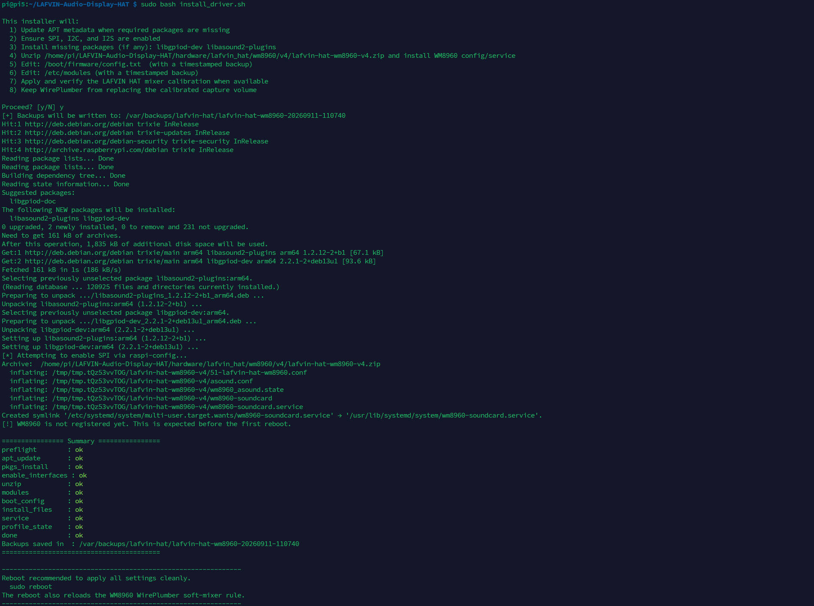

.. _clone-and-install-driver:

1. Clone the Project and Install the Drivers
============================================

.. important::
   Run the commands in this chapter from the terminal of a regular Raspberry
   Pi user. Do not clone the project as the root user. The deployment script
   needs to identify the regular user who owns the project directory.

Clone the Project
-----------------

.. code-block:: bash

   sudo apt update
   sudo apt install -y git python3-venv
   cd ~
   git clone https://github.com/lafvintech/LAFVIN-Audio-Display-HAT.git
   cd ~/LAFVIN-Audio-Display-HAT

Confirm that the project files are present:

.. code-block:: bash

   ls

The output should include ``install_driver.sh``, ``deploy``, ``src``, and
``apps``.

Install the Hardware Profile
----------------------------

.. code-block:: bash

   sudo bash install_driver.sh

The script installs the required system dependencies and configures SPI, I2C,
I2S, the WM8960 audio profile, and related services. You must restart the
Raspberry Pi after the installation finishes:

.. code-block:: bash

   sudo reboot

.. caution::
   The WM8960 sound card may not be registered until after the restart. This is
   expected. Do not assume that the driver installation failed before
   restarting, and do not manually modify the boot configuration files to
   bypass the installation script.

After the Raspberry Pi restarts, log in again through SSH and return to the
project directory:

.. code-block:: bash

   cd ~/LAFVIN-Audio-Display-HAT

Continue to :ref:`Verify the Hardware <verify-hardware>`.
