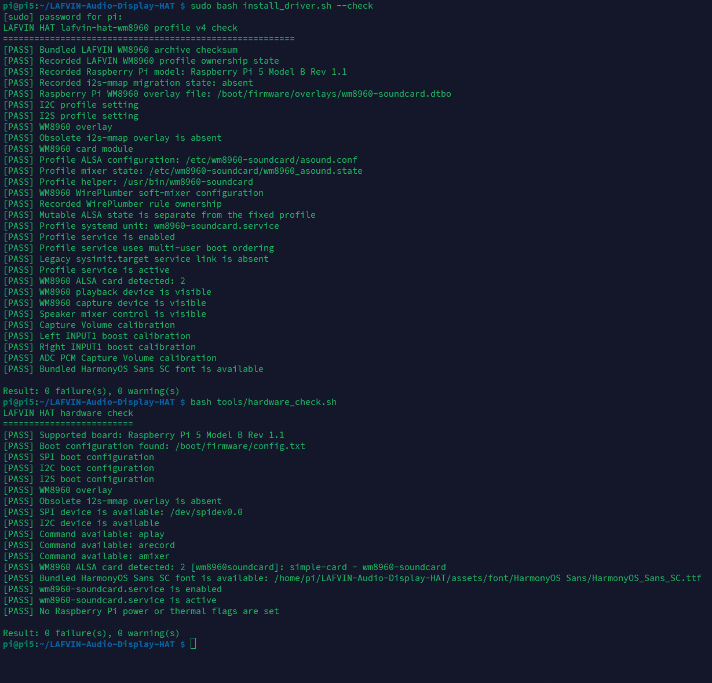
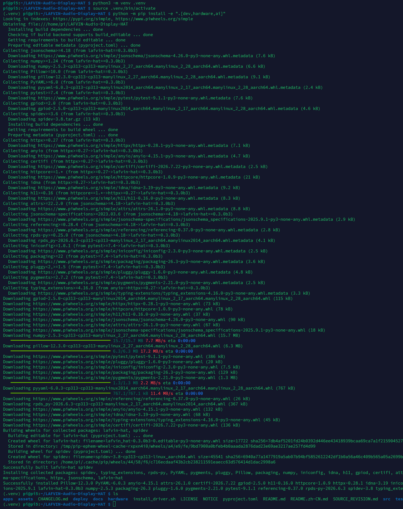
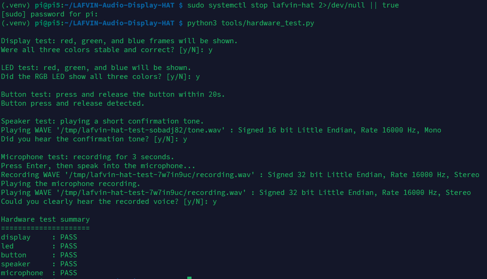

.. _verify-hardware:

2. Verify the Hardware
======================

This chapter first verifies the drivers and system interfaces, then uses an
interactive test to check all major HAT peripherals. Continue to the AI
configuration and deployment only after these checks pass.

Check the Drivers and System Interfaces
---------------------------------------

Run the following commands from the project directory:

.. code-block:: bash

   sudo bash install_driver.sh --check
   bash tools/hardware_check.sh

Both commands should finish with:

.. code-block:: text

   Result: 0 failure(s)

Create the Project Environment
------------------------------

The interactive hardware test requires the project's Python dependencies. Run
the following commands from the project directory:

.. code-block:: bash

   python3 -m venv .venv
   source .venv/bin/activate
   python -m pip install -e ".[dev,hardware,ai]"

Run the Interactive Hardware Test
---------------------------------

If the Runtime has been deployed previously, stop it first. The hardware test
accesses the display, GPIO, and audio devices directly.

.. code-block:: bash

   sudo systemctl stop lafvin-hat 2>/dev/null || true
   python3 tools/hardware_test.py

Follow the terminal prompts and verify each item:

* The display shows red, green, and blue test screens.
* The RGB LED displays different colors.
* Button presses and releases are detected.
* The test tone is audible.
* The microphone recording plays back successfully.

At the end of the test, the terminal displays the result for each subsystem. If
any item fails, stop and follow :ref:`Troubleshooting <troubleshooting-guide>`.
Do not skip a failed check and continue with the deployment.

If all checks pass, continue to the next chapter.
