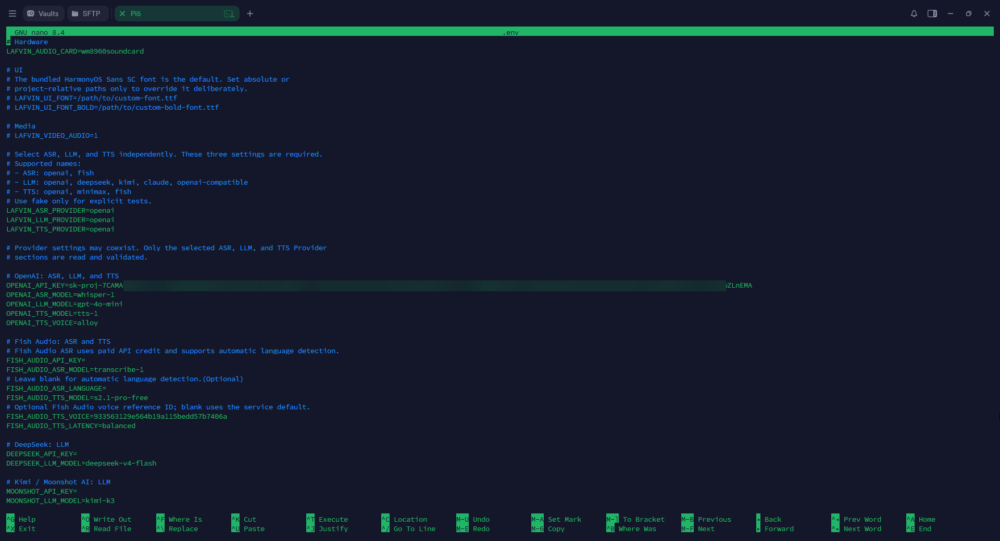
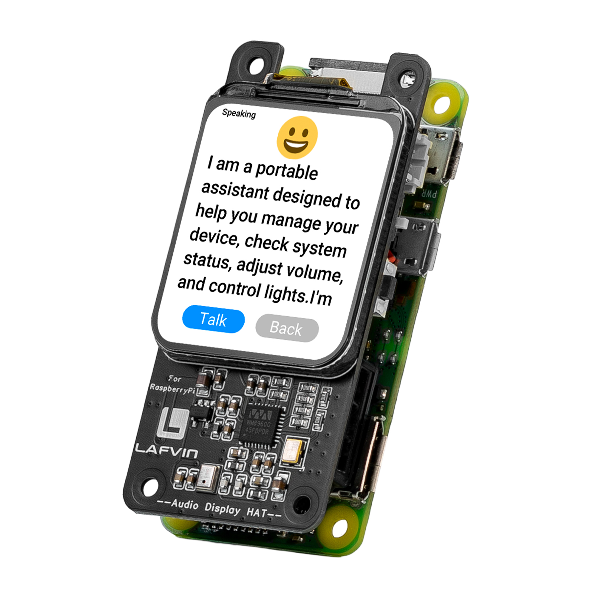
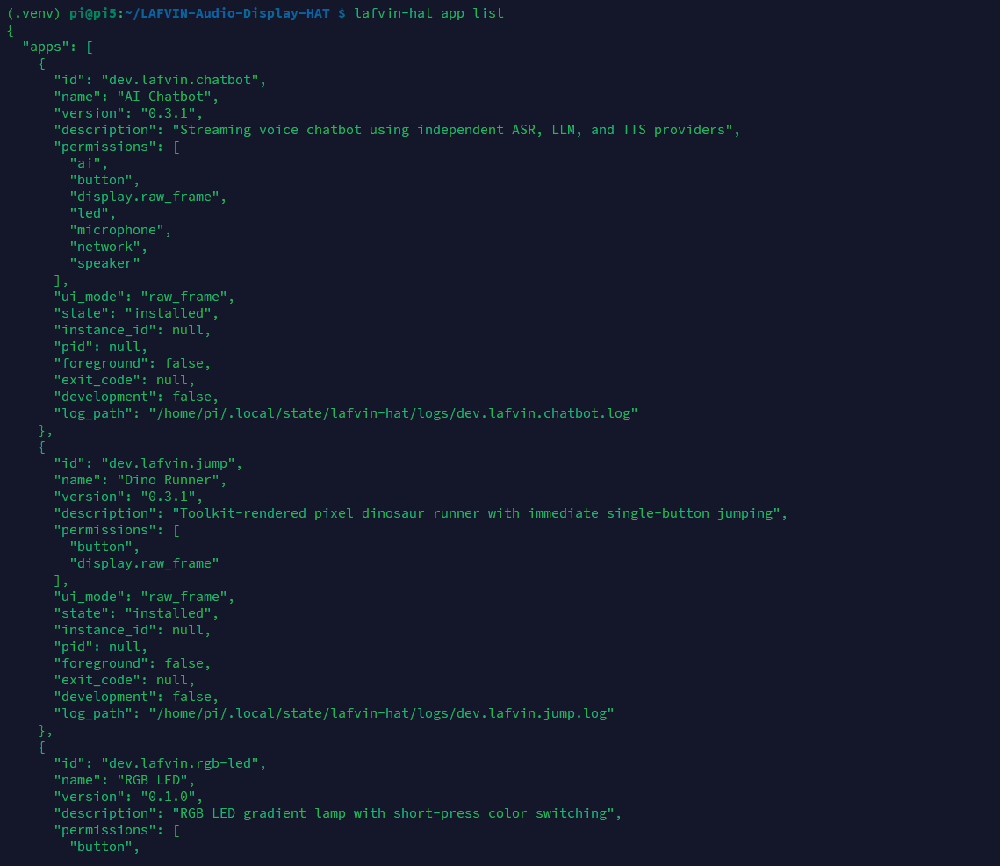

.. _configure-runtime:

3. Configure and Test the Runtime
=================================

The Runtime manages the display, button, RGB LED, backlight, audio, application
lifecycles, and application data. After completing the hardware checks in the
previous chapter, you will start the Runtime in the foreground with a live
cloud AI service. This verifies the Chatbot, Translator, and built-in
applications before using the same configuration for the startup service.

Prepare an API Key
------------------

The recommended configuration uses OpenAI for speech recognition, the language
model, and speech synthesis, so it requires only one ``OPENAI_API_KEY``. Create
a key on the `OpenAI API Keys page
<https://platform.openai.com/api-keys>`_ and make sure the API account has
available credit.

.. warning::
   OpenAI API usage is billed separately from ChatGPT. A ChatGPT subscription
   does not include API usage, and API calls may incur additional charges. See
   `OpenAI API billing
   <https://help.openai.com/en/articles/9039756>`_ for details.

Create the Environment File
---------------------------

With ``.venv`` activated, run:

.. code-block:: bash

   cp .env.example .env
   nano .env

Make sure all three Provider settings use ``openai``, then enter your API key:

.. code-block:: ini

   LAFVIN_ASR_PROVIDER=openai
   LAFVIN_LLM_PROVIDER=openai
   LAFVIN_TTS_PROVIDER=openai
   OPENAI_API_KEY=your-openai-api-key

Replace ``your-openai-api-key`` with your actual key. You can keep the default
OpenAI model and voice settings from ``.env.example``. In nano, press
``Ctrl+O``, then ``Enter`` to save the file, and press ``Ctrl+X`` to exit.

.. warning::
   The ``.env`` file contains your API key. Do not commit it to Git, paste it
   into chat messages, or include it in screenshots.

Start and Validate the Runtime
------------------------------

.. code-block:: bash

   lafvin-hat runtime start --env-file .env --backend lafvin-hat

Basic Button Controls
^^^^^^^^^^^^^^^^^^^^^

* **Single-click**: Move to the next menu item or action button.
* **Double-click**: Open the selected application or confirm the selected
  action.
* **Triple-click**: Exit the current application or page and return to the Home
  screen.
* In Chatbot or Translator, select ``Talk`` or ``Translate``, then hold the
  button to start recording and release it to submit the recording.

.. note::
   Some applications assign their own actions to the button. Follow the
   instructions shown on the display.

Confirm that the HAT display reaches the Home screen, then use the button to
browse the built-in applications. Open Chatbot, select ``Talk``, hold the
button while speaking, and release it to submit the recording. Confirm that
the application recognizes your speech, generates a response, and plays the
spoken reply. The terminal should not report API key, credit, model, or network
errors. If you plan to use Translator, complete one live translation test
during this foreground run as well.

.. note::
   ``.env.example`` also includes settings for other supported service
   providers. You can select and combine the ASR, LLM, and TTS Providers
   independently. For example, you can use Fish Audio for speech recognition,
   DeepSeek to generate responses, and MiniMax for speech synthesis:

   .. code-block:: ini

      LAFVIN_ASR_PROVIDER=fish
      LAFVIN_LLM_PROVIDER=deepseek
      LAFVIN_TTS_PROVIDER=minimax

   After changing a Provider, enter the corresponding service API key and
   review its model and voice settings.

If the cloud AI test fails, check ``.env`` and the network connection before
continuing. Do not deploy a configuration that has not passed validation. To
isolate the problem, see
:ref:`Use Fake Providers to Isolate Problems <fake-provider-diagnostics>`.

In a second SSH terminal, check the Runtime information and application list:

.. code-block:: bash

   cd ~/LAFVIN-Audio-Display-HAT
   source .venv/bin/activate
   lafvin-hat info
   lafvin-hat app list

After validation is complete, press ``Ctrl+C`` in the terminal running the
Runtime to stop it cleanly. Then continue to
:ref:`Deploy the Runtime <run-and-deploy>`. In the next chapter, the validated
``.env`` file can be imported automatically into
``/etc/lafvin-hat/runtime.env``, so you do not need to enter the Provider and
API key settings again.
