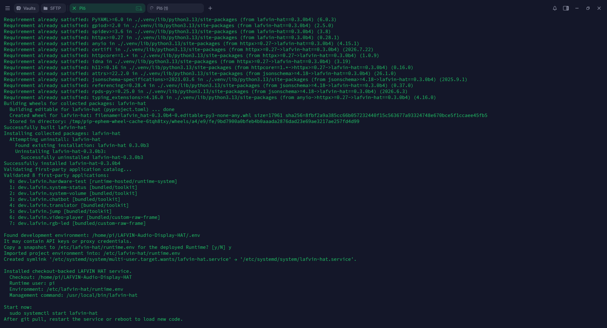

.. _run-and-deploy:

4. Deploy the Runtime as a Startup Service
==========================================

This chapter registers the validated project directory as a systemd service.
The deployment uses the current Git checkout and its ``.venv`` instead of
copying the project source code. If you later move or rename the project
directory, run the deployment script again.

Deploy the Runtime
------------------

Make sure the manually started Runtime from the previous chapter has been
stopped with ``Ctrl+C``, then run the following commands from the project
directory:

.. code-block:: bash

   cd ~/LAFVIN-Audio-Display-HAT
   sudo bash deploy/install_raspberry_pi.sh

During the first deployment, if the project contains a ``.env`` file, the
installer asks whether to copy it to
``/etc/lafvin-hat/runtime.env`` as the persistent configuration. Before
importing it, make sure the API key in the file is correct. The installer
copies the file and does not remove the project's original ``.env`` file.

.. attention::
   If an API configuration error appears after deployment, edit
   ``/etc/lafvin-hat/runtime.env``. Save the file, then run
   ``sudo systemctl restart lafvin-hat`` to apply the new configuration.

Start and Check the Service
---------------------------

.. code-block:: bash

   sudo systemctl start lafvin-hat
   sudo systemctl status lafvin-hat --no-pager
   lafvin-hat info
   lafvin-hat app list

``lafvin-hat.service`` should report ``active (running)``. After deployment,
you can use the ``lafvin-hat`` management commands without activating
``.venv``.

The deployment creates or uses the following locations:

.. list-table::
   :header-rows: 1
   :widths: 35 65

   * - Location
     - Purpose
   * - ``/etc/lafvin-hat/runtime.env``
     - Persistent Runtime configuration, which may contain API keys
   * - ``/var/lib/lafvin-hat``
     - Application data and managed applications
   * - ``/var/log/lafvin-hat``
     - Runtime and application logs

Verify the Deployment After Restarting
--------------------------------------

.. code-block:: bash

   sudo reboot

After the Raspberry Pi restarts, log in again and run:

.. code-block:: bash

   systemctl status lafvin-hat --no-pager
   systemctl status wm8960-soundcard --no-pager

``lafvin-hat.service`` should report ``active (running)``,
``wm8960-soundcard.service`` should report ``active (exited)``, and the HAT
display should automatically show the Runtime interface. This confirms that
the first-time installation is complete.

To remove the Runtime service or hardware profile later, see
:ref:`Uninstall the Runtime and Drivers <uninstall-runtime-and-drivers>`.
