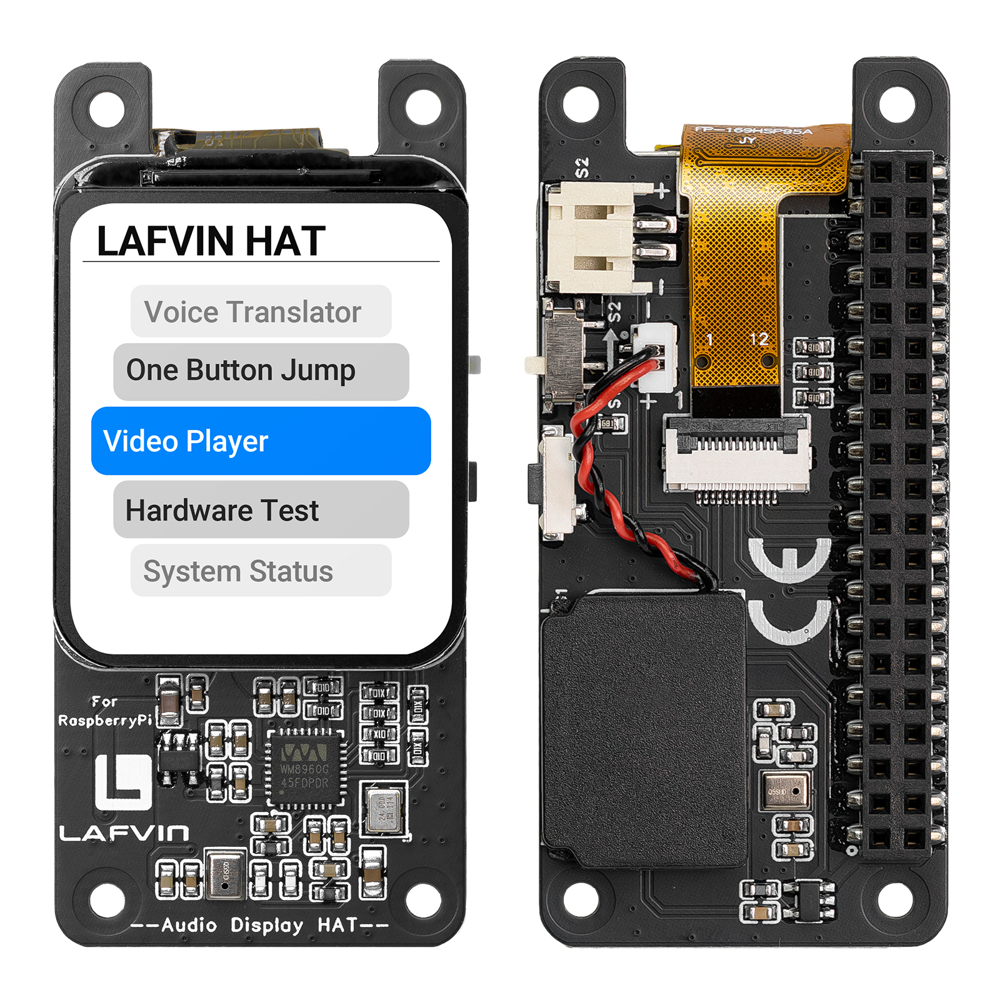
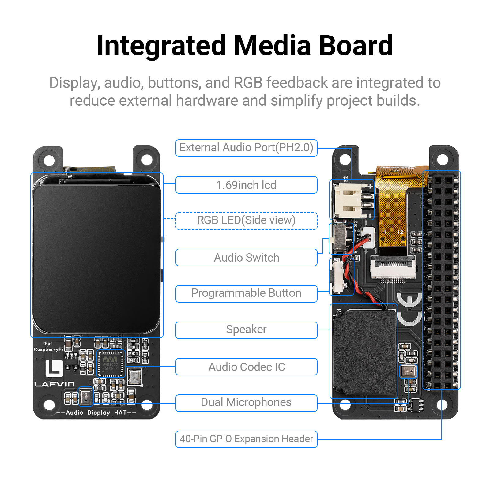

.. _about-this-kit-page:

About This Kit
==============

Product Overview
----------------

The LAFVIN Audio Display HAT is an audio and display expansion board that
connects to a Raspberry Pi through its standard 40-pin GPIO header. It combines
a color display, audio recording, speaker playback, a physical button, and an
RGB status LED on a compact circuit board. It is suitable for voice-interaction
terminals, desktop information displays, media players, and interactive games.

The HAT is not a standalone computer and must be used with a compatible
Raspberry Pi. The display is not a touchscreen; all interaction is performed
with the onboard physical button.

Key Features
------------

.. rst-class:: wide-feature-list

* 1.69-inch IPS color display for images, text, animations, and device status.
* WM8960 audio codec for audio recording and playback.
* Two onboard MEMS microphones for voice capture.
* Onboard 8-ohm, 1-watt speaker, plus an external speaker connector and selector switch.
* Programmable RGB LED, display backlight, and physical button.
* SPI, I2C, and I2S peripherals for Python-based multimedia application development.

Hardware Specifications
-----------------------

.. list-table::
   :header-rows: 1
   :widths: 30 70

   * - Item
     - Specification
   * - Host interface
     - Standard Raspberry Pi 40-pin GPIO header
   * - Power
     - 5 V supplied through the Raspberry Pi GPIO header
   * - Display
     - 1.69-inch IPS LCD, 240 × 280, ST7789, 4-wire SPI, 262K colors
   * - Audio codec
     - WM8960; I2S for audio data and I2C for configuration
   * - Microphones
     - Two AOS3729A-T42-NXC analog MEMS microphones
   * - Audio output
     - Onboard 8-ohm, 1-watt speaker and an external speaker connector
   * - Other peripherals
     - RGB LED, physical button, and display backlight
   * - Communication interfaces
     - SPI, I2C, and I2S
   * - Dimensions
     - Approximately 6.5 × 3 × 1.2 cm

Package Contents
----------------

.. list-table::
   :header-rows: 1
   :widths: 10 60 20

   * - No.
     - Item
     - Quantity
   * - 1
     - LAFVIN Audio Display HAT board
     - 1

.. note::
   This list is based on the official product page and includes only the HAT
   board explicitly listed there. A Raspberry Pi, power supply, microSD card,
   and card reader must be provided separately. If your package includes other
   accessories, refer to the packing list supplied with the product.

Compatibility and Requirements
------------------------------

The project has been verified on the Raspberry Pi Zero 2 W, Raspberry Pi 3
Model B+, Raspberry Pi 4 Model B, and Raspberry Pi 5. Raspberry Pi OS 64-bit is
recommended. The project has been tested with the Trixie image released on
June 18, 2026.

Before starting, prepare a stable 5 V power supply suitable for your Raspberry
Pi model, a microSD card, a card reader, an internet-connected computer, and a
network connection. When using cloud services with AI Chatbot or Translator,
you also need an API key from the corresponding service provider.

.. warning::
   Before installing or removing the HAT, shut down the Raspberry Pi and
   disconnect its power supply. Hold the board by its PCB edges. Do not press
   on the display, and do not allow liquids or metal objects to contact the
   circuit board.

Tutorial Path
-------------

.. list-table::
   :header-rows: 1
   :widths: 30 70

   * - Stage
     - Completion criteria
   * - :ref:`Prepare the Raspberry Pi <preparation-guide>`
     - Raspberry Pi OS has been written to the microSD card, the HAT has been
       installed correctly while power is disconnected, and you can log in to
       the operating system.
   * - :ref:`Install and deploy <tutorial>`
     - The driver and Runtime are installed; the display, audio, RGB LED, and
       physical button have passed verification; and Runtime starts
       automatically at boot.
